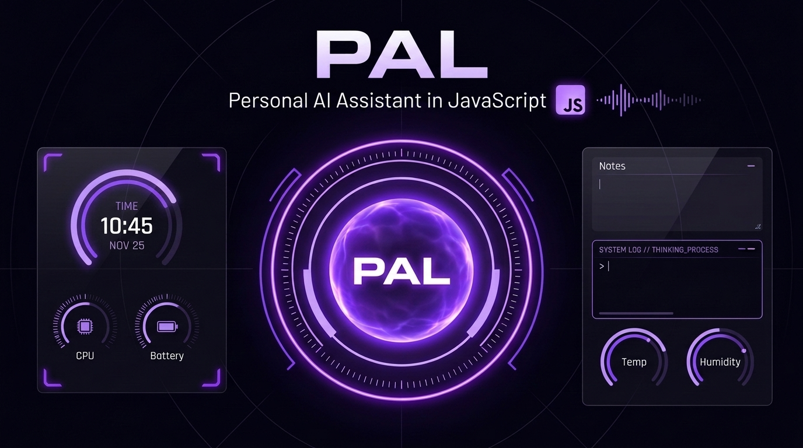
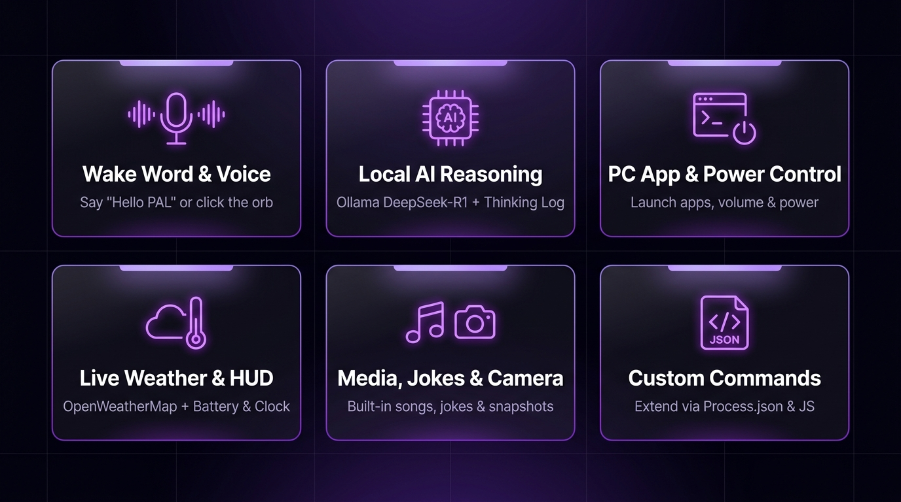
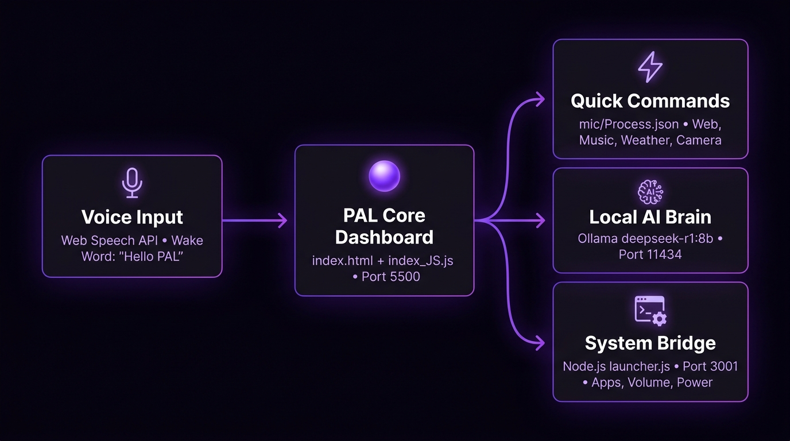

# PAL — Personal AI Assistant in JavaScript



**PAL** (*Personal Assistant Lifeform*) is a futuristic, voice-controlled desktop AI dashboard built with HTML, CSS, JavaScript, Node.js, and local LLM reasoning via **Ollama**. It combines an animated violet/purple sci-fi HUD, always-on wake-word voice recognition, local system controls, and streaming AI responses in the browser.

---

## ✨ Key Features



- **Wake Word & Continuous Voice Control** — Uses the browser Web Speech API (`en-IN`, multi-alternative matching). Say **"Hello PAL"**, **"Hey PAL"**, or **"PAL"** to wake it up, or click the central **PAL** orb manually.
- **Local AI Reasoning (Ollama)** — Streams responses from `deepseek-r1:8b` (`http://localhost:11434/api/generate`), displays live `<think>` reasoning tokens in the **SYSTEM LOG // THINKING_PROCESS** panel, and executes compound `[[ACTION: ...]]` tool calls.
- **PC App, Volume & Power Bridge** — Local Node.js bridge ([launcher.js](./launcher.js) on port `3001`) lets PAL launch Windows apps (`notepad`, `calc`, `chrome`, `code`, `spotify`, `discord`, `cmd`, `powershell`, Office apps, etc.), adjust system volume (`up`, `down`, `mute`), and trigger/cancel power actions (`shutdown`, `restart`, `logout`, `cancel`).
- **Live Sci-Fi HUD Widgets** — Real-time date & time arc gauges, device battery status, live temperature/humidity/weather icon via OpenWeatherMap, and an editable on-screen **Notes** panel.
- **Web Search, Media, Jokes & Camera** — Dynamic Google/YouTube/Wikipedia/Amazon searches, built-in music player (tracks in `mic/`), audio jokes, webcam snapshot popup ([mic/Camera2.html](./mic/Camera2.html)), friend list ([mic/friendList.html](./mic/friendList.html)), and quick utilities (coin flip, dice roll, internet speed, system info).
- **Standalone Mini-Orb Mode** — Lightweight secondary assistant view available at [mic/index1.html](./mic/index1.html).

---

## 🏗️ Architecture



| Component | File / Port | Responsibility |
| :--- | :--- | :--- |
| **PAL Core Dashboard** | [index.html](./index.html), [Style.css](./Style.css), [index_JS.js](./index_JS.js) (`:5500`) | HUD UI, Web Speech recognition/TTS, weather/battery/clock widgets, command matching, and Ollama streaming |
| **Quick Commands Registry** | [mic/Process.json](./mic/Process.json) | Maps normalized voice phrases to JavaScript actions |
| **System Bridge** | [launcher.js](./launcher.js) (`:3001`) | Node.js HTTP server executing local app launches, PowerShell volume keys, and Windows power commands |
| **Local AI Brain** | Ollama (`:11434`) | `deepseek-r1:8b` model for conversational replies, reasoning log, and multi-action orchestration |
| **One-Click Launcher** | [start_pal.bat](./start_pal.bat) | Starts the static server (`:5500`), starts `launcher.js` (`:3001`), and opens PAL in your browser |

---

## 🚀 Getting Started

### Prerequisites

- **Google Chrome** or **Microsoft Edge** (for Web Speech API support)
- **Node.js** (required for `launcher.js` and `start_pal.bat`)
- **OpenWeatherMap API Key** (for the weather & temperature widget)
- **Ollama** *(optional, required for AI conversation & compound actions)* with `deepseek-r1:8b`

### Step 1: Clone or Download the Repository

```bash
git clone <your-repo-url>
cd pal-ai-assistant
```

### Step 2: Configure Your OpenWeatherMap API Key

1. Create an account and generate an API key at [openweathermap.org/appid](https://openweathermap.org/appid).
2. Open [index_JS.js](./index_JS.js) and replace `"YOUR_API_KEY"` on line 1 with your key:
   ```js
   const API_KEY = "YOUR_API_KEY"; // For OpenWeatherMap
   ```
   *(If you also use the standalone mini-orb at [mic/index1.html](./mic/index1.html), update `API_KEY` in [mic/app1.js](./mic/app1.js) as well.)*

### Step 3: Set Up Local AI with Ollama *(Optional)*

1. Install [Ollama](https://ollama.com/) and pull the model used by PAL:
   ```bash
   ollama pull deepseek-r1:8b
   ```
2. Allow browser CORS requests from the local dashboard by setting the `OLLAMA_ORIGINS` environment variable to `*` before running Ollama:
   ```powershell
   $env:OLLAMA_ORIGINS="*"
   ollama serve
   ```

### Step 4: Launch PAL

#### Option A — One-Click Windows Launcher *(Recommended)*

Double-click **[start_pal.bat](./start_pal.bat)** (or run it from terminal):

```bat
start_pal.bat
```

This automatically:
1. Serves the project on `http://localhost:5500` via `npx -y serve -l 5500`
2. Starts the Node.js System Bridge (`node launcher.js`) on `http://localhost:3001`
3. Opens `http://localhost:5500/index.html` in your default browser

#### Option B — VS Code Live Server + Manual Bridge

1. Start the System Bridge in a terminal:
   ```bash
   node launcher.js
   ```
2. Open the folder in **VS Code** and launch [index.html](./index.html) with the **Live Server** extension (port `5500` is preconfigured in [.vscode/settings.json](./.vscode/settings.json)).

---

## 🛠️ Adding Custom Voice Commands

1. **Add the action function** in [index_JS.js](./index_JS.js) (or [mic/app1.js](./mic/app1.js) for the standalone mini-orb):
   ```js
   function openPortfolio() {
     Speak("Opening your portfolio, sir.");
     openWeb("https://example.com");
   }
   ```
2. **Register the voice phrase** in [mic/Process.json](./mic/Process.json):
   ```json
   {
     "open my portfolio": "openPortfolio();"
   }
   ```
   > **Tip:** `NormalizeText()` in [index_JS.js](./index_JS.js) automatically strips punctuation and filler words (`please`, `pal`, `sir`, `hey`, `hello`, `the`, `a`, `an`, etc.) and normalizes `open`/`start`/`launch`/`run` to `open` for more flexible matching.
3. *(Optional)* To let the Ollama AI agent trigger your new function in multi-step commands, document it inside `PAL_SYSTEM_PROMPT` at the top of [index_JS.js](./index_JS.js).

---

## 📝 Permissions & Troubleshooting

- **Browser Permissions:** Allow **Microphone** (voice commands), **Location** (weather widget), **Camera** (snapshot mode in `mic/Camera2.html`), and **Pop-ups** (for opening sites, camera, and friend list windows).
- **Audio / Passive Listening Not Starting Immediately:** Browsers often block speech synthesis or recognition until the first user gesture. Click anywhere on the page or click the central **PAL** orb to activate listening.
- **`AI Service Offline (Check Ollama)`:** Ensure Ollama is running on port `11434`, `deepseek-r1:8b` is downloaded, and `OLLAMA_ORIGINS=*` is set so the browser does not fail on CORS.
- **Local Apps / Volume / Power Commands Not Working:** Make sure `node launcher.js` is running on port `3001` (automatically handled by `start_pal.bat`). Note that `launcher.js` targets Windows commands (`start`, PowerShell `wscript.shell`, `shutdown`).
